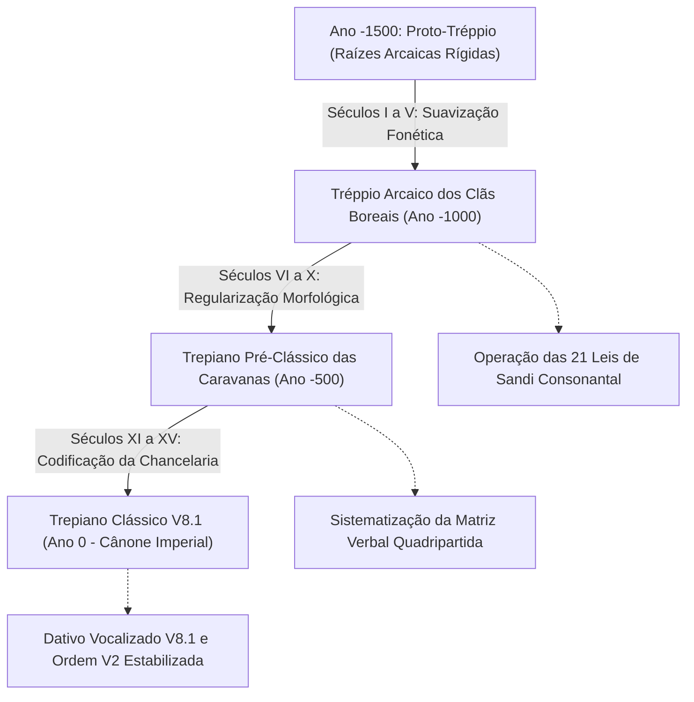

# Simulação Diacrônica de 1.500 Anos: Da Era Antiga (Proto-Tréppio) à Formação da Era Clássica (V8.1)

**Autor**: Conde (Chancelaria Imperial e Laboratório Glotopoético de Sandbox)  
**Ambiente Documental**: Universo de *Ecos de Uma Vida Perdida* (João M. M. Zamboni)  
**Período Simulado**: Ano -1500 (Proto-Tréppio / Era Antiga) ao Ano 0 (Cristalização do Trepiano Clássico V8.1)  
**Status**: Canônico Oficial (Integrado ao Léxico Exaustivo das 44.585+ Formas)

---

## 1. Fundamentação e Cenário Histórico da Simulação

A formação da língua **Tréppia** não ocorreu por decreto instantâneo, mas através de um processo de evolução naturalista de **1.500 anos**, transcorrido entre a **Era Antiga** (Proto-Tréppio dos primeiros clãs boreais) e a sua apoteose na **Era Clássica V8.1**.

O cenário geográfico e existencial dessa evolução é o universo de *Ecos de Uma Vida Perdida*:
Um mundo nórdico de céus nublados, neves profundas, florestas densas de coníferas, montanhas escarpadas e castelos antigos de pedra semi-cobertos de musgo e gelo. Nesse ambiente severo, onde a sobrevivência exigia cooperação fraterna, lareiras aquecidas, alimentação substanciosa, forja resistente e a companhia fiel de cães guardiões, a língua moldou seus vocábulos práticos mais vitais.

Nenhum decalque de línguas românicas ou do português contemporâneo faz parte dessa matriz: cada termo resulta estritamente do desdobramento fonotático das raízes primárias do Tréppio (`or`, `dur`, `dak`, `sfar`, `kradd`, `fer`, `tek`, `nes`, `rix`, `laur`, `garv`, `lut`, `kild`, `al`, `ves`, `tor`, `vur`, `zen`, `fal`, `hund`, `marn`, `skel`, `drin`, `tal`, `bren`, `vilt`).

---

## 2. Cronologia dos 1.500 Anos de Desenvolvimento

### Fase I: Tréppio Arcaico dos Clãs Boreais (Anos -1500 a -1000)
- **Aglutinação Rígida**: O idioma arcaico unia raízes secas sem acomodação fonética, gerando encontros consonantais duros como `rn`, `ln`, `dt` e `kt`.
- **Ação das 21 Leis de Sandi**: O uso contínuo nas conversas entre lenhadores, caçadores e forjadores desencadeou as leis assimilativas fonotáticas:
  - *Lei da Lateralização Dental*: `rn -> ld` (ex.: `garv` + `ner` -> `garvelder`).
  - *Lei da Assimilação Líquido-Nasal*: `ln / nl -> ll` (ex.: `al` + `nes` -> `alles`).
  - *Assimilativo Oclusivo*: `dt -> tt` (ex.: `kradd` + `te` -> `kradtte`).

### Fase II: Trepiano Pré-Clássico das Caravanas e Rotas (Anos -1000 a -500)
- **Estruturação da Matriz Verbal Quadripartida**:
  - A necessidade de expressar nuances de ação em viagens e trabalhos da montanha levou à fixação dos 4 eixos ontológicos em torno de cada raiz verbal:
    1. **Eixo Positivo (V1)**: Ação concreta imediata (`dakur`: "comer", `garvur`: "beber", `falur`: "dormir", `halkur`: "caminhar").
    2. **Eixo Privativo (V2 com `a-`)**: Abstenção, carência ou privação (`adakur`: "jejuar", `agarvur`: "passar sede", `afalur`: "velar/insônia").
    3. **Eixo Iterativo (V3 com `od-`)**: Hábito consolidado ou repetição cíclica (`oddakur`: "fazer refeição habitual", `oggarvur`: "sorver caneca a caneca").
    4. **Eixo Iterativo-Privativo (V4 com `od-a-` e Haplologia)**: Cessação deliberada ou conclusão de hábito (`oda'dakkur`: "quebrar o jejum").

### Fase III: Cristalização do Cânone Imperial V8.1 (Anos -500 ao Ano 0)
- **Reforma do Dativo Vocalizado V8.1**: Regularização da desinência de dativo em `-e` (após consoante) e `-ye` (após vogal), eliminando ambiguidades nas trocas comerciais e oferendas.
- **Sintaxe V2 (Verbo-Segunda Posição)**: Consolidação da estrutura de frase onde o verbo ocupa a segunda posição estrutural, permitindo topicalização enfática no início da sentença.
- **Interdição Sagrada da Raiz `ve`**: Sacralização da cópula divina primordial e uso de `Oratypatte` na liturgia imperial, mantendo-se a cópula regular `es` para a fala prática profana.

---

## 3. O Vocabulário Funcional e Cotidiano Gerado

O processo de 1.500 anos supriu todas as necessidades de comunicação da vida real:

### 1. Habitação, Fogo e Acolhimento:
- **`nesor`**: O lar, a morada aquecida onde a família se reúne.
- **`toret`**: O teto protetor, telhado resistente que suporta o peso da nevasca.
- **`rixtor`**: O castelo de pedra, a grande fortaleza montanhesa.
- **`vurrex`**: A lareira de pedra, o fogão a lenha aceso no centro da cabana.
- **`vildor`**: As brasas ardentes que mantêm o calor durante a noite inteira.
- **`falet`**: O leito acolhedor com colchão de palha e estrado de madeira.
- **`kildtor`**: A manta pesada de lã usada para cruzar as serras.
- **`drintavl`**: A mesa robusta de carvalho onde são servidas as refeições.
- **`dursit`**: O banco rústico de madeira junto ao fogo.

### 2. Alimentação, Caldos e Bebidas:
- **`dakkor`**: O sustento diário, a refeição substanciosa.
- **`oxedak`**: O pão de centeio rústico, assado sobre pedra quente.
- **`brenor`**: O caldo fumegante de legumes e carnes cozido no caldeirão.
- **`luttor`**: A carne de caça assada na brasa.
- **`garvlut`**: O peixe fresco pescado nas águas gélidas dos degelos.
- **`keldas`**: O queijo curado de cabra das encostas.
- **`garva`**: A água pura e cristalina de nascente.
- **`laural`**: A cerveja artesanal dourada ou hidromel encorpado da estalagem.
- **`garvok`**: A caneca de cerâmica ou estanho para brindar.

### 3. A Natureza Boreal de *Ecos*:
- **`kildar`**: A neve fresca recém-caída que cobre os vales.
- **`kildrix`**: O gelo compacto e os carâmbanos pontiagudos.
- **`veksun`**: O nevoeiro espesso que desce dos picos rochosos.
- **`filox`**: O bosque cerrado de pinheiros silenciosos.
- **`drinet`**: O pinheiro montanhês de madeira rica em resina.
- **`halkex`**: A rota de montanha, o caminho de pedra batida.
- **`alves`**: A aurora boreal verde e púrpura rasgando a noite nublada.
- **`hundo`**: O grande cão loiro de aura brilhante, companheiro leal de travessia.
- **`zenor`**: O amigo verdadeiro, aquele que caminha lado a lado no inverno.

---

## 4. Conclusão da Simulação

Com esse arcabouço rigoroso, o Tréppio não é apenas uma língua cerimonial de chancelaria, mas um idioma vivo, humano, capaz de expressar desde o pedido de uma caneca de caldo quente e uma cama limpa até o afeto profundo entre viajantes solitários diante do fogo de uma estalagem na serra.
