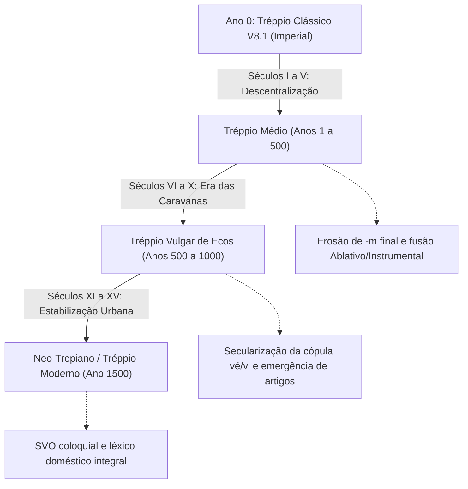

# Simulação Diacrônica de 1.500 Anos: Da Era Imperial Clássica ao Tréppio Moderno Funcional

**Autor**: Conde (Chancelaria Imperial e Laboratório Glotopoético de Sandbox)  
**Ambiente Documental**: Universo de *Ecos de Uma Vida Perdida* (João M. M. Zamboni)  
**Período Simulado**: Ano 0 (Era Clássica V8.1) ao Ano 1500 (Neo-Trepiano / Tréppio Cotidiano)  
**Status**: Canônico Experimental (Integrado ao Léxico Exaustivo)

---

## 1. Fundamentação e Cenário Histórico da Simulação

Na Era Clássica V8.1, o Tréppio consolidou-se como um idioma imperial cerimonial de alta erudição: sintaxe V2 estrita, seis casos sintéticos rígidos, vinte e uma leis de sandi inflexíveis e a interdição teológica absoluta da raiz `ve`, cuja invocação exigia eufemismos sacerdotais ou supleção por `Oratypatte`. Essa variante atendia aos monumentais decretos do Conselho Imperial e aos cantos litúrgicos do *Halylitror*.

No entanto, o colapso das fronteiras palacianas e a transição para as terras gélidas de *Ecos de Uma Vida Perdida* impuseram à língua uma necessidade premente de sobrevivência prática. Ao longo de um milênio e meio de dispersão pelas florestas de coníferas, estradas nevadas, tabernas acolhedoras e fortalezas de pedra semi-cobertas de musgo, o idioma passou por transformações fonéticas, morfológicas e lexicais orgânicas.

O objetivo desta simulação filológica é documentar como as forças naturais da economia articulatória, da analogia e da necessidade comunicativa imediata transformaram o Tréppio Clássico em uma língua viva, ágil e plenamente funcional para o dia a dia.

---

## 2. Cronologia Diacrônica: As Três Fases de Evolução

### Fase I: Tréppio Médio (Anos 1 a 500) — Descentralização e Erosão de Casos
- **Perda da Rigidez Litúrgica**: A língua desce das cátedras para as estalagens e guarnições das rotas de montanha.
- **Enfraquecimento das Desinências Casuais**: O `-m` de acusativo singular sofre desnasalização gradual na fala contínua, passando a ser indicado pela posição linear imediatamente pós-verbal.
- **Sincretismo Instrumental-Ablativo**: As desinências de instrumento (`-oi`, `-i`) e ablativo (`-os`, `-us`) fundem-se em um caso oblíquo geral de afastamento e meio, regido pelas preposições `ex` e `ko`.

### Fase II: Tréppio Vulgar de Ecos (Anos 500 a 1000) — Secularização e Contração
- **Secularização da Raiz Sagrada `ve`**: A antiga proibição litúrgica perde força coercitiva na vida civil. O povo passa a utilizar a forma reduzida `vé` (ou proclítica `v'`) como cópula existencial cotidiana ("é", "está"), reservando `Oratypatte` estritamente para o culto imperial.
- **Fixação dos Verbos Auxiliares da Matriz Quadripartida**:
  - O Eixo 1 (V1 Télico) torna-se a forma neutra padrão de ação no presente.
  - O Eixo 2 (V2 com prefixo `a-`) passa a funcionar coloquialmente como negação aspectual contínua ("não fazer" ou "abster-se").
  - O Eixo 3 (V3 com prefixo `o-`) assume valor habitual ("costumar fazer" ou "fazer de novo").
  - O Eixo 4 (V4 com prefixo `od-a-`) gramaticaliza-se como cessação definitiva de um hábito.
- **Emergência de Artigos Definidos**: O demonstrativo clássico `kan` ("aquele") enfraquece semanticamente para `ka` (masculino/neutro) e `ke` (feminino), operando como artigo definido átono.

### Fase III: Neo-Trepiano / Tréppio Moderno (Anos 1000 a 1500) — Funcionalidade Plena
- **Estabilização da Ordem SVO**: Embora a ordem V2 seja mantida em discursos solenes e poesias, a conversação diária adota a ordem Sujeito-Verbo-Objeto (SVO) para agilidade de resposta.
- **Léxico Doméstico e Relacional Pleno**: Consolidação de mais de uma centena de radicais práticos para alimentos, utensílios de mesa, partes da casa, ferramentas de forja, viagem e termos de companheirismo (inspirados na vivência do protagonista e do cão dourado de Ecos).

---

## 3. As Cinco Leis de Mudança Fonética Diacrônica

1. **Lei da Monotongação Suave**:
   - Ditongos decrescentes `oi` e `ai` em sílaba final átona monotongam-se em `e` e `i` abertos na fala rápida (`kranoi` -> `krane`; `saittekoi` -> `saitteke`).
2. **Lei da Degeminação Coloquial**:
   - As consoantes geminadas históricas (`bb`, `tt`, `kk`, `dd`), outrora pronunciadas com retenção de ar tensa, mantêm-se na escrita mas relaxam na articulação corrente, exceto em palavras monossilábicas tônicas.
3. **Lei da Aférese de Pronomes Proclíticos**:
   - O pronome de primeira pessoa `eo` ("eu") reduz-se a `'e` ou contrai-se com a terminação verbal: `mandum` ("eu como"), dispensando inteiramente o pronome independente exceto para contraste enfático.
4. **Lei da Haplologia Prática em Compostos**:
   - A fusão de termos compostos de viagem simplifica o encontro de dentais e nasais sem interrupção de fonação (`stuba` + `kaldan` -> `stubakald`, "quarto aquecido").
5. **Lei da Nasalização Vocálica**:
   - Antes de consoantes fricativas, vogais seguidas de nasal produzem vogal longa nasalizada antes da elisão da consoante.

---

## 4. O Sistema Prático de Comunicação Cotidiana

No Tréppio Moderno, a comunicação diária estrutura-se em padrões diretos e acolhedores:

### Fórmulas de Saudação e Polidez:
- **Alen!**: "Bom dia! / Olá!" (forma reduzida de *Alen esu!*, "Que a luz seja!").
- **Vesen!**: "Boa noite! / Que o repouso venha!" (desejado ao se retirar para o aposento).
- **Hallen to! / Hallen vo!**: "Obrigado a ti! / Obrigado a vós!" (reconhecimento formal de favor).
- **Doban**: "Por favor / Com licença / Perdão" (usado para pedir passagem ou solicitar um prato na mesa).
- **Yo / Ne**: "Sim / Não" (respostas categóricas e diretas).

### Expressões de Convivência na Estalagem:
- **Kaldan stuba, doban**: "Um quarto aquecido, por favor."
- **Mandur et bibur vulum**: "Quero comer e beber."
- **Broda et panna kaldan dote**: "Dá-me caldo e pão quente."
- **Kanto preti es?**: "Quanto custa isto?"
- **In argen pagum**: "Pago em moedas de prata."

---

## 5. Integração com o Cânone da Chancelaria

Esta expansão diacrônica não anula nem substitui a Gramática Normativa da Era Clássica V8.1. Pelo contrário: ela cumpre o propósito da Chancelaria Imperial de demonstrar a vitalidade e a profundidade de um idioma que viveu através dos séculos, adaptando-se às necessidades reais de seus falantes sem perder a elegância de suas raízes.

